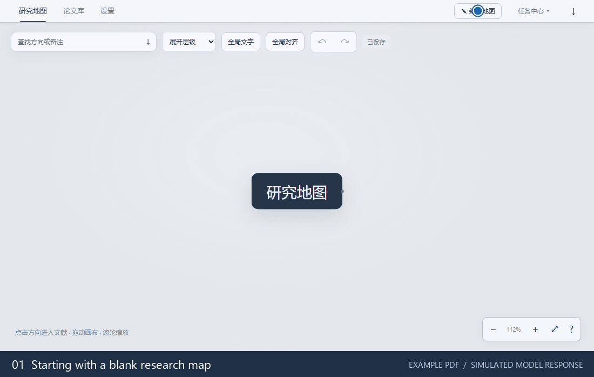

# Research Map Webpage

> 本地研究地图、论文库与 AI 论文阅读工具。

[](https://www.python.org/) [](https://developer.mozilla.org/docs/Web/JavaScript) [](https://www.microsoft.com/windows) [](https://www.sqlite.org/)

---

## 项目介绍

Research Map Webpage 是一个**适用于不同学科**的本地研究工具，用思维导图组织研究方向，并把论文、推荐和引用关系挂在对应方向下。




- **数据在本机**：研究数据保存在本地 SQLite 数据库，原 PDF 和完整正文不持久保存。
- **PDF 先本地解析**：在内存中完成双解析与 OCR 交叉核对，再把文字交给配置的 API 提取题录、摘要、参考文献并评分。
- **从空白地图开始**：新数据库只有一个「研究地图」根节点，研究方向在编辑模式下自行添加。

核心功能：

- **研究地图**：编辑研究方向、层级、备注、样式与布局。
- **论文库**：搜索、归类、移动、移除或永久删除论文；一篇论文可关联多个方向。
- **PDF 批量阅读**：一次可选择多份 PDF；最多两篇同时处理，其余按提交顺序在内存中排队。API 负责内容提取和评分，阅读证据可在详情页查看。
- **发表信息**：区分上传 PDF、预印本和正式版本；优先采用原文中的正式发表信息，支持重新联网查询和手动矫正。
- **个人文献视图**：时间轴、影响力图和引用网络；引用网络只连接有参考文献证据的关系。
- **最新推荐**：按方向及父级研究背景调研近期论文，提供概要和原文链接。
- **任务中心**：查看本次运行的任务、阶段、耗时、警告和错误，可中断或清空。
- **模型连接**：启动时自动获取模型列表并测试连通性；按日、周、月查看调用、Token 和参考费用。
- **备份与恢复**：导出或恢复研究数据与设置的 JSON 备份。

---

## 快速上手

### 环境依赖

- **便携运行**：Windows 10/11 x64。便携目录自带 Python 运行时和 PDF/OCR 依赖，无需另装 Python。
- **源码运行（可选）**：不使用自带运行时的 Windows 环境需安装 Python 3.11 或更新版本，依赖清单位于 `src/requirements.txt`。
- **模型服务**：一个兼容 Responses API 的模型服务地址及 API Key。

### 获取与安装

1. 解压或复制完整的发布目录，保留 `runtime/` 和 `src/` 的相对位置。便携运行无需安装 Python。
2. 如只下载了源码、没有 `runtime/`，可在项目根目录运行以下命令：

   ```powershell
   python -m venv .venv
   .\.venv\Scripts\python.exe -m pip install -r .\src\requirements.txt
   ```


### 运行与验证

1. **启动**：
   - 双击 `启动研究地图.bat`。浏览器打开本机页面，通常是 `http://127.0.0.1:8765`，端口以 CMD 显示为准。

2. **确认运行**：
   - CMD 窗口显示服务地址，网页能打开研究地图。
   - 已保存密钥时，任务中心出现「启动模型检查」：先获取模型列表，再用上次选择的模型测试文字连接、快速提取和联网搜索；结果也显示在「设置 → 模型连接」。
3. **停止**：关闭启动用的 CMD 窗口或按 `Ctrl+C`。

### 基础配置

在「设置 → 模型连接」中填写并保存：

- **Base URL**：服务商提供的 Responses API 基础地址，不附加 `/responses` 或 `/models`；首次启动为空。
- **API Key**：加密保存在 `data/model-credential.dpapi`，绑定当前 Windows 账户；**更换设备或账户后需重新输入**。
- **模型**：可手动填写，也可点击「获取可用模型」后选择；保存的模型会作为下次启动的默认模型。
- **网络方式**：默认「自动」，先探测系统代理路径，不通时改用直连并短暂记住可用路径；也可固定为系统代理或直连。
  - 已发出的模型请求超时后**不会换路重发**。
---

## 使用指南

### 基本工作流

1. **搭建地图**：在编辑模式下添加研究方向和备注。
2. **上传论文**：在方向页面选择一份或多份 PDF。最多两篇同时处理；其余在任务中心显示为排队，可取消，关闭服务后不会保留。开始处理后，论文先进入论文库并显示「AI阅读中」，阅读完成后补充摘要、参考文献和评分。
3. **查看与整理**：在论文详情查看发表信息、评分和阅读证据；可设置用户评分、论文标签和简短备注，或移动、移除、删除论文。
4. **浏览关系**：在个人文献中切换时间轴、影响力图和引用网络；在最新推荐中查看近期相关论文。
5. **备份**：在「设置 → 备份与恢复」导出 JSON 并单独保存。

### 发表信息

- **取用优先级**：手动矫正 > 上传论文原文中的正式发表信息 > API 联网调研。
- **从文章中提取**：PDF 首页能定位到已发表或已录用的期刊/会议时直接采用，不再自动联网补查。
  - 投稿中（submitted to）、审稿中和 arXiv 不算正式发表信息。
- **自动联网调研**：原文没有正式发表信息时由 API 联网查询；首轮只找到 arXiv 会再定向搜索正式版本，仍未找到记为警告。结果标注「AI 调研生成，可能有误」。
- **重新联网查询**：位于「手动矫正」左侧。
  - 原文中提取的平台、DOI 和日期**不会被覆盖**。
  - 原文没有发表信息时，新结果替换上一次 AI 联网结果。
  - 已手动矫正的论文不能重新联网查询。
- **详情折叠**：展开「详细发表信息」可查看版本、来源和调研说明。

### 备注、标签和方向

- **简短备注**：写在论文详情标题上方，显示在时间轴卡片标题下方并按卡片宽度自动换行；同篇论文的各方向共用。
- **论文标签**：「设置 → 论文标签」可新增、改名、停用标签，并设置图标字符、文字颜色、图标颜色和背景色。停用标签保留已有标记，但不能再新选。
- **方向关联**：移除某一方向不会删除论文；失去全部方向的论文保留在未归类文献中；永久删除会清除该论文的全部关联数据。

### 推荐、引用和任务

- **最新推荐**：结合完整方向路径调研，不会自动加入论文库；可按方向关闭推荐。
- **引用网络**：只连接由已收录论文的参考文献证据确认的关系。
- **任务中心**：鼠标悬停右上角查看本次运行的任务；PDF 排队、阅读、参考文献提取和联网补查分别记录。

### 目录结构

| 位置 | 用途 |
| --- | --- |
| `启动研究地图.bat` | 启动服务并保持 CMD 窗口，关闭窗口即停止 |
| `src/` | Python 后端、前端静态文件和依赖清单 |
| `cache/` | 启动后生成的本机缓存 |
| `data/` | 启动后生成的数据库、加密密钥、运行日志和备份 |
| `runtime/` | 便携版 Python 和 PDF/OCR 运行依赖 |
| `docs/` | 使用演示和第三方组件说明 |

- **发布版数据**：首次启动创建空白地图和论文库；不要将个人 `data/` 或导出的备份放入公开仓库。
- **隐私**：PDF 在本地解析，阅读所需的文字会发给配置的模型服务；处理受限制的材料前，请核对服务商的数据政策。

---

## 常见问题 (FAQ)

- **Q: 关闭窗口会停止服务吗？**
  - **A**: 关闭启动脚本的 CMD 窗口或按 `Ctrl+C` 会停止服务；只关闭浏览器标签页不会。服务停止后，页面可能仍显示先前内容，但无法保存或加载新数据。

- **Q: 每次启动都会调用模型吗？**
  - **A**: 已保存密钥时会。启动检查会获取模型列表，并做一次完整连接测试，会产生少量 Token 用量。上次选择的模型不在返回列表中时只记警告，仍按该模型测试；获取列表失败不影响连接测试。

- **Q: 测试连接成功，论文阅读仍可能失败吗？**
  - **A**: 可能。长文分阶段阅读受模型上下文、网关超时和网络路由影响；具体失败阶段记录在任务详情中。

- **Q: PDF 在什么位置裁切？**
  - **A**: 先定位参考文献，再识别参考列表结束后的附录或补充材料。无法可靠确定分界时会保留后续内容；参考文献未能提取时单独告警，正文评分和已有引用资料会保留。

- **Q: 为什么论文显示「从文章中提取」，而没有联网查询？**
  - **A**: 上传的 PDF 首页写明了正式期刊或会议，原文信息优先。仍可点击「重新联网查询」补充其他资料，但不会改动原文中的平台、DOI 和日期。

- **Q: 备份包含哪些内容？**
  - **A**: 版本 4 保存当前导图、节点备注、个人论文库（含未归类文献）、阅读资料和设置。
    - 不导出：已删除节点、撤销与重做历史、推荐、未收录题录、任务、错误、用量记录和加密密钥。
    - 恢复版本 2 或 3 时同样丢弃隐藏节点及历史；更换设备后需单独配置密钥。

- **Q: 删除方向后，关联论文怎么办？**
  - **A**: 立即解除该方向的论文关联。论文保留其他方向；失去最后一个方向时，论文连同评分和阅读结果留在未归类文献中。撤销删除只恢复节点及导图内容；服务重启或恢复备份后撤销记录清空。

---

## 开源与许可证

**Copyright © 2026 littlewells**（[版权声明](COPYRIGHT)）。

项目自身代码使用 **GNU Affero General Public License v3.0（AGPL-3.0）**，详见 [`LICENSE`](LICENSE)。`runtime/` 同时含第三方二进制，其许可和源码入口见 [第三方许可及对应源码](docs/third-party.md)。

**便携版源码获取：** [第三方说明](docs/third-party.md)列出 PDF 版面分析、图像与数值库的对应版本、源码下载和构建资料。分发 `runtime/` 时一同保留此说明及原有许可。
